 

  <a href="https://alkaid.live"><b>alkaid.live ↗</b></a>&nbsp;&nbsp;·&nbsp;&nbsp;
  <a href="https://github.com/AlkaidSTART/call-code">call-code</a>&nbsp;&nbsp;·&nbsp;&nbsp;
  <a href="https://github.com/AlkaidSTART/coderelay">coderelay</a>&nbsp;&nbsp;·&nbsp;&nbsp;
  <a href="https://simple-design-zeta.vercel.app">simple-design</a>&nbsp;&nbsp;·&nbsp;&nbsp;
  <a href="https://juejin.cn/user/3780587447942084">掘金</a>&nbsp;&nbsp;·&nbsp;&nbsp;
  <a href="https://gitee.com/ALIOTHK">Gitee</a>

  &nbsp;
  &nbsp;
  &nbsp;
  

---

### 01 · Focus & Stack

- **Frontend & Cross-Platform** — `React` · `Vue 3` · `Next.js` · `TypeScript` · `Tauri 2` · `Flutter` · `TanStack Query` · `Zustand`
- **Backend & Systems** — `Go (Gin)` · `Python (FastAPI)` · `Node.js` · `Bun` · `PostgreSQL` · `Redis` · `Supabase`
- **AI & Agent Infrastructure** — `LangGraph` · `LangChain` · `CLI Coding Agents` · `Multi-Agent TTY Routing`

---

### 02 · Selected Works & Writing

<table>
  <tr>
    <td width="50%" valign="top">

**Featured Projects**

- **[call-code](https://github.com/AlkaidSTART/call-code)** — 本地终端编程智能体（TypeScript + Ink），支持自然语言驱动文件读写、长效记忆与自主规划。
- **[coderelay](https://github.com/AlkaidSTART/coderelay)** — 多 Coding Agent 智能路由网关与交互式 TUI，支持自适应任务分发与 TTY 会话接管。
- **[simple-design](https://simple-design-zeta.vercel.app)** — 轻量级 Web 视觉设计工具，缩短从「灵感」到「成品」的创作路径。

</td>
    <td width="50%" valign="top">

**Selected Writing · [alkaid.live ↗](https://alkaid.live)**

- **[深入浅出 React Hooks 原理](https://alkaid.live/blog/react-hooks/)** — 从 Fiber `memoizedState` 单向链表到 `updateQueue` 并发调度机制。
- **[TanStack Query 异步状态管理核心实践](https://alkaid.live/blog/TanStack%20Query%20%E6%8A%80%E6%9C%AF%E6%8C%87%E5%8D%97%EF%BC%9A%E5%BC%82%E6%AD%A5%E7%8A%B6%E6%80%81%E7%AE%A1%E7%90%86%E6%A0%B8%E5%BF%83%E5%AE%9E%E8%B7%B5/)** — 剖析 SWR 缓存生命周期、后台静默同步与乐观更新架构。
- **[Zustand 极简原子化状态管理方案](https://alkaid.live/blog/0%20%E5%9F%BA%E7%A1%80%E5%85%A5%E9%97%A8%20Zustand%EF%BC%9A%E6%96%B0%E6%89%8B%E5%8F%8B%E5%A5%BD%E7%9A%84%20React%20%E7%8A%B6%E6%80%81%E7%AE%A1%E7%90%86%E6%A0%B8%E5%BF%83%E6%96%B9%E6%A1%88/)** — 基于发布订阅与 `useSyncExternalStore` 的零样板状态隔离实践。

</td>
  </tr>
</table>

---

### 03 · GitHub Stats & Activity

<table>
  <tr>
    <td width="48%" valign="middle" align="center">
      
    </td>
    <td width="52%" valign="top">

**Recent Activity**

<!-- START_SECTION:activity -->
- `2026.10.25` · `STAR` — **[tamagui/tamagui](https://github.com/tamagui/tamagui)**
- `2026.10.22` · `STAR` — **[yangzongzhuan/RuoYi](https://github.com/yangzongzhuan/RuoYi)**
- `2026.10.18` · `PUSH` — **[AlkaidSTART/TimePulse](https://github.com/AlkaidSTART/TimePulse)** (`main`)
- `2026.10.18` · `PUSH` — **[AlkaidSTART/TimePulse](https://github.com/AlkaidSTART/TimePulse)** (`dev-alkaidstart`)
- `2026.10.20` · `STAR` — **[GeWu-academy/Modu-AI](https://github.com/GeWu-academy/Modu-AI)**
<!-- END_SECTION:activity -->

</td>
  </tr>
</table>

  <picture>
    <source media="(prefers-color-scheme: dark)" srcset="https://raw.githubusercontent.com/AlkaidSTART/AlkaidSTART/output/github-contribution-grid-snake-dark.svg" />
    <source media="(prefers-color-scheme: light)" srcset="https://raw.githubusercontent.com/AlkaidSTART/AlkaidSTART/output/github-contribution-grid-snake.svg" />
    
  </picture>

 

  
    <code>η URSAE MAJORIS · ALKAID</code> &nbsp;—&nbsp; <i>Gaze at the stars, engineer on solid ground.</i>
  

