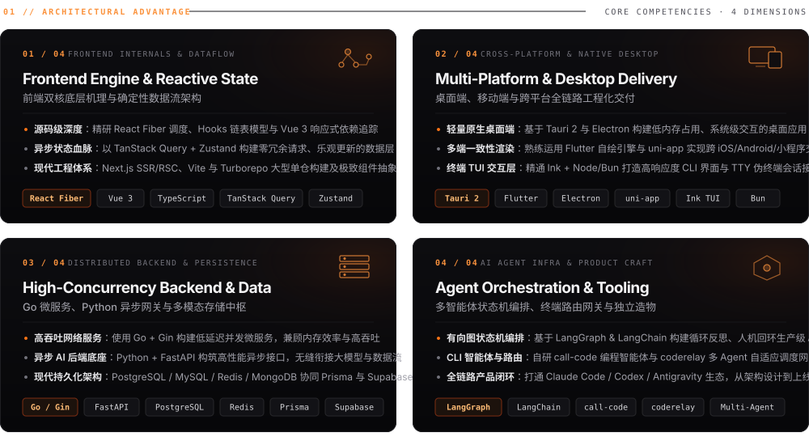
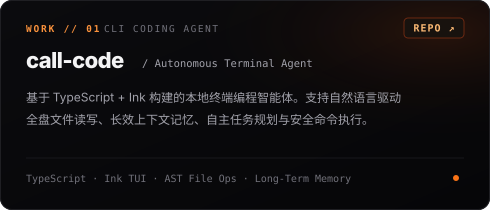
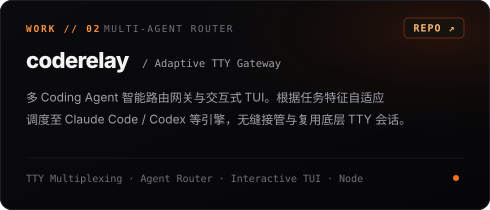
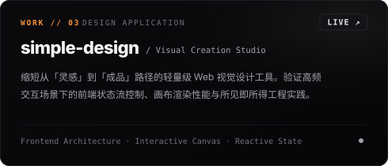
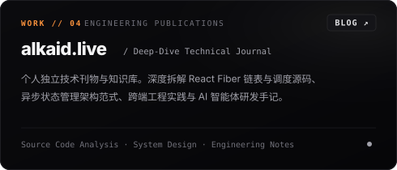
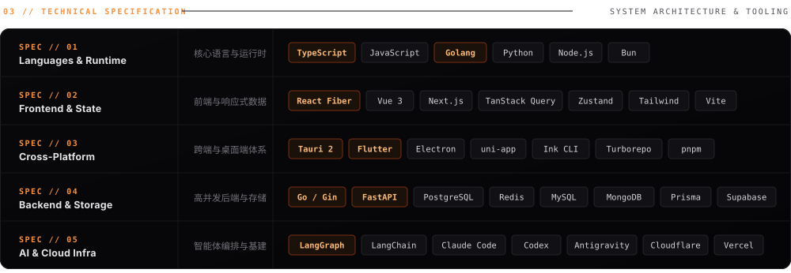

<!-- 00 // HERO MANIFESTO & CELESTIAL INSTRUMENT -->

 

<!-- EDITORIAL NAVIGATION & MONOCHROME TELEMETRY BAR -->

  <a href="https://alkaid.live"><code>01 // ALKAID.LIVE ↗</code></a>&nbsp;&nbsp;·&nbsp;&nbsp;
  <a href="https://github.com/AlkaidSTART/call-code"><code>02 // CALL-CODE ↗</code></a>&nbsp;&nbsp;·&nbsp;&nbsp;
  <a href="https://github.com/AlkaidSTART/coderelay"><code>03 // CODERELAY ↗</code></a>&nbsp;&nbsp;·&nbsp;&nbsp;
  <a href="https://simple-design-zeta.vercel.app"><code>04 // SIMPLE-DESIGN ↗</code></a>&nbsp;&nbsp;·&nbsp;&nbsp;
  <a href="https://juejin.cn/user/3780587447942084"><code>05 // JUEJIN ↗</code></a>&nbsp;&nbsp;·&nbsp;&nbsp;
  <a href="https://gitee.com/ALIOTHK"><code>06 // GITEE ↗</code></a>

  &nbsp;
  &nbsp;
  &nbsp;
  &nbsp;
  

 

<!-- 01 // ARCHITECTURAL ADVANTAGE (4-PILLAR BENTO GRID) -->

  

 

<!-- 02 // SELECTED WORKS (INTERACTIVE 2x2 BENTO MATRIX) -->

  

  
  

  
  

 

<!-- 03 // TECHNICAL SPECIFICATION MATRIX -->

  

 

<!-- 04 // WRITING & LIVE TELEMETRY -->

  

<table>
  <tr>
    <td width="54%" valign="top">
      <b>SELECTED ESSAYS // 深度技术长文 (<a href="https://alkaid.live">alkaid.live ↗</a>)</b>
        
      <code>01</code> &nbsp;<a href="https://alkaid.live/blog/react-hooks/"><b>深入浅出 React Hooks 原理</b></a> 
      &nbsp;&nbsp;&nbsp;&nbsp;&nbsp;&nbsp;从 Fiber 节点的 <code>memoizedState</code> 单向链表讲到 <code>updateQueue</code> 环形并发调度机制。
        
      <code>02</code> &nbsp;<a href="https://alkaid.live/blog/TanStack%20Query%20%E6%8A%80%E6%9C%AF%E6%8C%87%E5%8D%97%EF%BC%9A%E5%BC%82%E6%AD%A5%E7%8A%B6%E6%80%81%E7%AE%A1%E7%90%86%E6%A0%B8%E5%BF%83%E5%AE%9E%E8%B7%B5/"><b>TanStack Query 异步状态管理核心实践</b></a> 
      &nbsp;&nbsp;&nbsp;&nbsp;&nbsp;&nbsp;剖析 Stale-While-Revalidate 缓存生命周期、后台静默同步与乐观更新架构。
        
      <code>03</code> &nbsp;<a href="https://alkaid.live/blog/0%20%E5%9F%BA%E7%A1%80%E5%85%A5%E9%97%A8%20Zustand%EF%BC%9A%E6%96%B0%E6%89%8B%E5%8F%8B%E5%A5%BD%E7%9A%84%20React%20%E7%8A%B6%E6%80%81%E7%AE%A1%E7%90%86%E6%A0%B8%E5%BF%83%E6%96%B9%E6%A1%88/"><b>Zustand 极简原子化状态管理方案</b></a> 
      &nbsp;&nbsp;&nbsp;&nbsp;&nbsp;&nbsp;基于发布订阅与 <code>useSyncExternalStore</code> 的零样板代码状态隔离实践。
    </td>
    <td width="46%" valign="top">
      <b>RECENT TELEMETRY // 实时工程脉搏</b>
        

<!-- START_SECTION:activity -->
- `2026.10.25` · `STAR` — **[tamagui/tamagui](https://github.com/tamagui/tamagui)**
- `2026.10.22` · `STAR` — **[yangzongzhuan/RuoYi](https://github.com/yangzongzhuan/RuoYi)**
- `2026.10.18` · `PUSH` — **[AlkaidSTART/TimePulse](https://github.com/AlkaidSTART/TimePulse)** (`main`)
- `2026.10.18` · `PUSH` — **[AlkaidSTART/TimePulse](https://github.com/AlkaidSTART/TimePulse)** (`dev-alkaidstart`)
- `2026.10.20` · `STAR` — **[GeWu-academy/Modu-AI](https://github.com/GeWu-academy/Modu-AI)**
<!-- END_SECTION:activity -->

  </td>
  </tr>
</table>

 

<!-- CONTRIBUTION TOPOLOGY -->

  <picture>
    <source media="(prefers-color-scheme: dark)" srcset="https://raw.githubusercontent.com/AlkaidSTART/AlkaidSTART/output/github-contribution-grid-snake-dark.svg" />
    <source media="(prefers-color-scheme: light)" srcset="https://raw.githubusercontent.com/AlkaidSTART/AlkaidSTART/output/github-contribution-grid-snake.svg" />
    
  </picture>

 

<!-- COLOPHON FOOTER -->

  
    <code>η URSAE MAJORIS · ALKAID</code> &nbsp;—&nbsp; <i>Gaze at the stars, engineer on solid ground.</i>
     
    <a href="https://alkaid.live">alkaid.live</a> &nbsp;·&nbsp;
    <a href="https://github.com/AlkaidSTART">GitHub</a> &nbsp;·&nbsp;
    <a href="https://juejin.cn/user/3780587447942084">Juejin</a> &nbsp;·&nbsp;
    <a href="https://gitee.com/ALIOTHK">Gitee</a>
  

