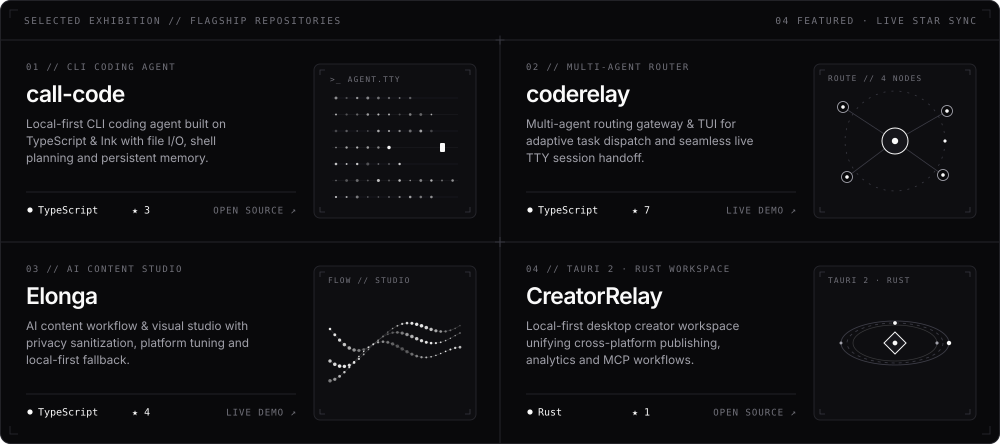
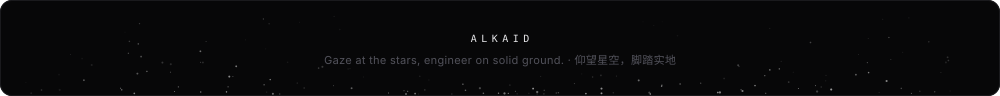

<!-- ═══════════════════════════════════ ACT 00 · KINETIC HERO ═══════════════════════════════════ -->
<a href="https://alkaid.live">
  <picture>
    <source media="(prefers-color-scheme: dark)" srcset="./assets/hero-dark.svg" />
    <source media="(prefers-color-scheme: light)" srcset="./assets/hero-light.svg" />
    
  </picture>
</a>

<!-- ═══════════════════════════════════ TYPING PULSE ═══════════════════════════════════ -->
<a href="https://alkaid.live">
  <picture>
    <source media="(prefers-color-scheme: dark)" srcset="https://readme-typing-svg.demolab.com?font=JetBrains+Mono&weight=400&size=12&duration=3400&pause=1400&color=C4C4CC&center=true&vCenter=true&width=820&height=30&lines=Resist+entropy+with+order.+Hold+meaning+with+space.;Building+CLI+Coding+Agents+%C2%B7+Multi-Agent+Routers+%C2%B7+Local-First+Tools;TypeScript+%C2%B7+React+19+%C2%B7+Next.js+16+%C2%B7+Go+%C2%B7+Python+%C2%B7+Rust+%2F+Tauri+2;%CE%B7+Ursae+Majoris+%C2%B7+%E4%BB%A5%E7%A7%A9%E5%BA%8F%E6%8A%B5%E6%8A%97%E7%86%B5%E5%A2%9E%EF%BC%8C%E4%BB%A5%E7%A9%BA%E7%99%BD%E6%89%BF%E8%BD%BD%E5%86%85%E5%AE%B9" />
    <source media="(prefers-color-scheme: light)" srcset="https://readme-typing-svg.demolab.com?font=JetBrains+Mono&weight=400&size=12&duration=3400&pause=1400&color=52525B&center=true&vCenter=true&width=820&height=30&lines=Resist+entropy+with+order.+Hold+meaning+with+space.;Building+CLI+Coding+Agents+%C2%B7+Multi-Agent+Routers+%C2%B7+Local-First+Tools;TypeScript+%C2%B7+React+19+%C2%B7+Next.js+16+%C2%B7+Go+%C2%B7+Python+%C2%B7+Rust+%2F+Tauri+2;%CE%B7+Ursae+Majoris+%C2%B7+%E4%BB%A5%E7%A7%A9%E5%BA%8F%E6%8A%B5%E6%8A%97%E7%86%B5%E5%A2%9E%EF%BC%8C%E4%BB%A5%E7%A9%BA%E7%99%BD%E6%89%BF%E8%BD%BD%E5%86%85%E5%AE%B9" />
    
  </picture>
</a>

<!-- ═══════════════════════════════════ COMMAND NAVIGATION & LIVE TELEMETRY ═══════════════════════════════════ -->

  &nbsp;
  &nbsp;
  &nbsp;
  &nbsp;
  &nbsp;
  &nbsp;
  

 

<!-- ═══════════════════════════════════ SECTION 01 · ARCHITECTURE & ICONIC STACK ═══════════════════════════════════ -->
<picture>
  <source media="(prefers-color-scheme: dark)" srcset="./assets/divider-01-dark.svg" />
  <source media="(prefers-color-scheme: light)" srcset="./assets/divider-01-light.svg" />
  
</picture>

<picture>
  <source media="(prefers-color-scheme: dark)" srcset="./assets/architecture-dark.svg" />
  <source media="(prefers-color-scheme: light)" srcset="./assets/architecture-light.svg" />
  
</picture>

 

<table>
  <tr>
    <td width="50%" valign="top">

#### `01` · Interface & Cross-Platform
现代 Web 交互界面、桌面原生封装与跨端应用工程

  
  
  
  
  
  
  
  
  
  
  

</td>
    <td width="50%" valign="top">

#### `02` · AI Agents & Coding Platforms
终端编程智能体、多 Agent 路由调度与前沿 AI 编程体系

  
  
  
  
  
  
  
  
  
  

</td>
  </tr>
  <tr>
    <td width="50%" valign="top">

#### `03` · Backend & Systems Runtime
高并发微服务、异步 AI 后端与原生系统底层

  
  
  
  
  
  
  
  

</td>
    <td width="50%" valign="top">

#### `04` · Data, Storage & Cloud Infra
数据持久化层、容器化部署与边缘云 CI/CD 体系

  
  
  
  
  
  
  
  
  
  
  

</td>
  </tr>
</table>

  
&nbsp;<code>CODEX</code> &nbsp;<b>Seven-Star Engineering Codex (北斗七星 · 极客星宿谱)</b> — click to inspect full architectural manifesto

   

> *“Alkaid（摇光）· 北斗之末 · 开阳之伴。每颗星辰，对应工程系统的一维法则。”*

| Index | Star · 星宿 | Domain | Deep Focus & Toolchain |
|:---:|:---|:---|:---|
| `01` | **天枢 · Dubhe** | **Interface & Cross-Platform** | **React 19** (Fiber / Hooks / Concurrent)、**Vue 3**、**Next.js 16**、**Tailwind CSS v4**、**Vite**、**GSAP**；跨端 **Tauri 2**、**Flutter**、**uni-app**、**Electron**；**Bun / pnpm / Turborepo** |
| `02` | **天璇 · Merak** | **Reactive Data & State** | **TanStack Query**（SWR 缓存生命周期、乐观更新、后台同步）与 **Zustand**（`useSyncExternalStore` 原子化状态） |
| `03` | **天玑 · Phecda** | **Systems & Persistence** | **Go (Gin, gRPC/Protobuf)**、**Python (FastAPI, Pydantic, Pandas)**、**Rust**、**Node.js (NestJS, Express, Socket.IO)**；**PostgreSQL / MySQL / SQLite / Redis / MongoDB / Prisma / TypeORM / Supabase** |
| `04` | **天权 · Megrez** | **Multi-Agent Orchestration** | **LangGraph** 有向状态图、**LangChain**、**CrewAI**、**Dify**、人机回环（HITL）与结构化 Prompt Engineering |
| `05` | **玉衡 · Alioth** | **AI Coding Platforms & Craft** | 构建 [**call-code**](https://github.com/AlkaidSTART/call-code)、[**coderelay**](https://github.com/AlkaidSTART/coderelay)、[**CreatorRelay**](https://github.com/AlkaidSTART/CreatorRelay)；深度实践 **Claude Code / Codex / Antigravity / GitHub Copilot / Gemini / Pi / OMP** 与 **MCP / TTY** 调度 |
| `06` | **开阳 · Mizar** | **Writing & Systems Analysis** | 独立站 [**alkaid.live**](https://alkaid.live) 与 [**掘金**](https://juejin.cn/user/3780587447942084) 深度技术写作，拆解 React Fiber 内核与工程方法论 |
| `07` | **摇光 · Alkaid** | **Philosophy & Delivery** | *“once code, build everywhere”* — Docker / Nginx / GitHub Actions / Vercel / Cloudflare / Figma，从 0 到 1 交付克制而长青的作品 |

 

<!-- ═══════════════════════════════════ SECTION 02 · SELECTED WORKS ═══════════════════════════════════ -->
<picture>
  <source media="(prefers-color-scheme: dark)" srcset="./assets/divider-02-dark.svg" />
  <source media="(prefers-color-scheme: light)" srcset="./assets/divider-02-light.svg" />
  
</picture>

<a href="https://alkaid.live/projects/">
  <picture>
    <source media="(prefers-color-scheme: dark)" srcset="./assets/works-dark.svg" />
    <source media="(prefers-color-scheme: light)" srcset="./assets/works-light.svg" />
    
  </picture>
</a>

 

<!-- 2 × 3 Editorial Bento Gallery (01 — 06 Flagship Works) -->
<table>
  <tr>
    <td width="50%" valign="top">

<code>01</code> · CLI CODING AGENT

### [call-code ↗](https://github.com/AlkaidSTART/call-code)

  &nbsp;
  

本地优先的终端编程智能体。通过自然语言自主驱动项目文件读写、Shell 命令规划与跨会话长期记忆，让 AI 直接扎根于命令行工作流。

  
  
  

</td>
    <td width="50%" valign="top">

<code>02</code> · MULTI-AGENT ROUTER

### [coderelay ↗](https://github.com/AlkaidSTART/coderelay)

  &nbsp;
  

多 Coding Agent 智能路由网关与交互式 TUI。依据任务复杂度自适应分发至不同编码代理，支持实时 TTY 会话接管与团队接力协作。

  
  
  

</td>
  </tr>
  <tr>
    <td width="50%" valign="top">

<code>03</code> · AI CONTENT STUDIO

### [Elonga ↗](https://github.com/AlkaidSTART/Elonga)

  &nbsp;
  

一体化 AI 新媒体推流与视觉创作台。覆盖多平台文案适配、发布前隐私脱敏审查、图像风格化与自动化运营月报，支持零 API Key 本地降级。

  
  
  

</td>
    <td width="50%" valign="top">

<code>04</code> · DESKTOP CREATOR WORKSPACE

### [CreatorRelay ↗](https://github.com/AlkaidSTART/CreatorRelay)

  &nbsp;
  

基于 **Rust + Tauri 2** 构建的本地优先多平台创作者桌面工作台。统一管理多平台账号、内容创作、跨平台发布任务、数据聚合与受控 MCP 工作流。

  
  
  

</td>
  </tr>
  <tr>
    <td width="50%" valign="top">

<code>05</code> · VISUAL DESIGN STUDIO

### [simple-design ↗](https://github.com/AlkaidSTART/simple-design)

  &nbsp;
  

「设计即成品」的轻量级 Web 视觉创作工具。化繁为简的画布交互体验，将从灵感到可交付成品的路径压缩至极致。

  
  
  

</td>
    <td width="50%" valign="top">

<code>06</code> · 3D WEB SUSPENSE GAME

### [NightHouse · 午夜别墅 ↗](https://github.com/AlkaidSTART/NightHouse)

  &nbsp;
  

桌面浏览器直达的单人第一人称 3D 写实悬疑探索游戏。融合 **PlayCanvas Engine 2** 实时 3D 场景渲染、**React 19** HUD 与 **IndexedDB** 本地存档。

  
  
  

</td>
  </tr>
</table>

  
&nbsp;<code>ARCHIVE</code> &nbsp;<b>Complete Project Archive · 56+ Original Repositories</b> — categorized from alkaid.live/projects

   

<table>
  <tr>
    <td width="34%" valign="top">

**`AGENT` · AI & Orchestration**

- **[DreamWeave](https://dream-weave-six.vercel.app)** · AI Agent Studio
- **[MemoAgent](https://github.com/AlkaidSTART/MemoAgent)** · 长期记忆迭代检索知识库
- **[gisfy](https://gisfy.vercel.app)** · AI 2D 游戏素材生成
- **[Doctor-copilot](https://github.com/AlkaidSTART/Doctor-copilot)** · 智能问诊协同
- **[cc-resource](https://github.com/AlkaidSTART/cc-resource)** · Agent 资源引擎
- **[MetaVoice](https://meta-voice.vercel.app)** · AI 语音交互应用
- **[file-visual-manager](https://github.com/AlkaidSTART/file-visual-manager)** · Rust + TS 文件可视化
- **[its](https://github.com/AlkaidSTART/its)** · *Your runner, model & policy*

</td>
    <td width="33%" valign="top">

**`CREATIVE` · Visual & Canvas**

- **[simple-design](https://simple-design-zeta.vercel.app)** · 轻量视觉设计台
- **[LUMINA](https://github.com/AlkaidSTART/LUMINA)** · 视觉创意实验
- **[voice](https://voice-smoky-five.vercel.app)** · 声画交互生成
- **[View-mindmap](https://github.com/AlkaidSTART/View-mindmap)** · 思维导图引擎
- **[SciCanvas](https://github.com/AlkaidSTART/SciCanvas)** · 科研图形画布
- **[painter](https://github.com/AlkaidSTART/painter)** · 生成式绘制工坊
- **[Html-Home](https://github.com/AlkaidSTART/Html-Home)** · HTML 创意陈列馆

</td>
    <td width="33%" valign="top">

**`PRODUCT` · Apps & Utilities**

- **[kaoyan-helper](https://kaoyan-helper-alpha.vercel.app)** · `★5` 考研效率助手
- **[TimePulse](https://time-pulse-two.vercel.app)** · 极简多计时器与世界时钟
- **[booklin](https://booklin.vercel.app)** · 阅读与知识管理
- **[DAYFLOW](https://github.com/AlkaidSTART/DAYFLOW)** · 日程心流工具
- **[DevWorkspace](https://github.com/AlkaidSTART/DevWorkspace)** · 开发者工作台
- **[what-to-eat](https://what-to-eat-orcin-seven.vercel.app)** · 饮食决策应用
- **[markdown-live](https://markdown-live-vert.vercel.app)** · 实时 Markdown 编辑器
- **[go-chatroom](https://github.com/AlkaidSTART/go-chatroom)** · Flutter + Go 即时通讯

</td>
  </tr>
</table>

 

<!-- ═══════════════════════════════════ SECTION 03 · TELEMETRY OBSERVATORY ═══════════════════════════════════ -->
<picture>
  <source media="(prefers-color-scheme: dark)" srcset="./assets/divider-03-dark.svg" />
  <source media="(prefers-color-scheme: light)" srcset="./assets/divider-03-light.svg" />
  
</picture>

<a href="https://github.com/AlkaidSTART">
  <picture>
    <source media="(prefers-color-scheme: dark)" srcset="./assets/telemetry-dark.svg" />
    <source media="(prefers-color-scheme: light)" srcset="./assets/telemetry-light.svg" />
    
  </picture>
</a>

 

<!-- 3D Isometric Contribution Blocks -->
<a href="https://github.com/AlkaidSTART">
  <picture>
    <source media="(prefers-color-scheme: dark)" srcset="./assets/blocks-dark.svg" />
    <source media="(prefers-color-scheme: light)" srcset="./assets/blocks-light.svg" />
    
  </picture>
</a>

 

<!-- Contribution Grid Snake -->
<picture>
  <source media="(prefers-color-scheme: dark)" srcset="https://raw.githubusercontent.com/AlkaidSTART/AlkaidSTART/output/github-contribution-grid-snake-dark.svg" />
  <source media="(prefers-color-scheme: light)" srcset="https://raw.githubusercontent.com/AlkaidSTART/AlkaidSTART/output/github-contribution-grid-snake.svg" />
  
</picture>

 

<table>
  <tr>
    <td width="100%">

  &nbsp;
  Auto-synced every 4 hours via GitHub Actions

<!-- START_SECTION:activity -->
- `2026.11.28` · `PR #16` — [Merged Pull Request #16](https://github.com/AlkaidSTART/Elonga/pull/16) in **[AlkaidSTART/Elonga](https://github.com/AlkaidSTART/Elonga)**
- `2026.11.28` · `PR #15` — [Merged Pull Request #15](https://github.com/AlkaidSTART/Elonga/pull/15) in **[AlkaidSTART/Elonga](https://github.com/AlkaidSTART/Elonga)**
- `2026.11.28` · `PR #14` — [Closed Pull Request #14](https://github.com/AlkaidSTART/Elonga/pull/14) in **[AlkaidSTART/Elonga](https://github.com/AlkaidSTART/Elonga)**
- `2026.11.28` · `PR #13` — [Merged Pull Request #13](https://github.com/AlkaidSTART/Elonga/pull/13) in **[AlkaidSTART/Elonga](https://github.com/AlkaidSTART/Elonga)**
- `2026.11.28` · `PR #11` — [Merged Pull Request #11](https://github.com/AlkaidSTART/Elonga/pull/11) in **[AlkaidSTART/Elonga](https://github.com/AlkaidSTART/Elonga)**
- `2026.11.28` · `PR #12` — [Merged Pull Request #12](https://github.com/AlkaidSTART/Elonga/pull/12) in **[AlkaidSTART/Elonga](https://github.com/AlkaidSTART/Elonga)**
<!-- END_SECTION:activity -->

</td>
  </tr>
</table>

  
&nbsp;<code>MIRRORS</code> &nbsp;<b>Live External API Telemetry Mirrors</b> — GitHub Stats · Streak · Top Languages · Pinned Card

   
  

    <table>
      <tr>
        <td width="50%" align="center">
          <picture>
            <source media="(prefers-color-scheme: dark)" srcset="https://github-readme-stats.vercel.app/api?username=AlkaidSTART&show_icons=true&bg_color=09090b&title_color=fafafa&icon_color=e5a93c&text_color=d4d4d8&ring_color=d97757&border_color=222227&include_all_commits=true&count_private=true" />
            <source media="(prefers-color-scheme: light)" srcset="https://github-readme-stats.vercel.app/api?username=AlkaidSTART&show_icons=true&bg_color=fafafa&title_color=09090b&icon_color=b8862d&text_color=27272a&ring_color=c66a4b&border_color=e2e2e7&include_all_commits=true&count_private=true" />
            
          </picture>
        </td>
        <td width="50%" align="center">
          <picture>
            <source media="(prefers-color-scheme: dark)" srcset="https://streak-stats.demolab.com?user=AlkaidSTART&background=09090b&border=222227&stroke=222227&ring=d97757&fire=e5a93c&currStreakNum=fafafa&sideNums=fafafa&currStreakLabel=d97757&sideLabels=71717a&dates=52525b" />
            <source media="(prefers-color-scheme: light)" srcset="https://streak-stats.demolab.com?user=AlkaidSTART&background=fafafa&border=e2e2e7&stroke=e2e2e7&ring=c66a4b&fire=b8862d&currStreakNum=09090b&sideNums=09090b&currStreakLabel=c66a4b&sideLabels=71717a&dates=a1a1aa" />
            
          </picture>
        </td>
      </tr>
      <tr>
        <td width="50%" align="center">
          <picture>
            <source media="(prefers-color-scheme: dark)" srcset="https://github-readme-stats.vercel.app/api/top-langs/?username=AlkaidSTART&layout=compact&langs_count=8&bg_color=09090b&title_color=fafafa&text_color=d4d4d8&border_color=222227" />
            <source media="(prefers-color-scheme: light)" srcset="https://github-readme-stats.vercel.app/api/top-langs/?username=AlkaidSTART&layout=compact&langs_count=8&bg_color=fafafa&title_color=09090b&text_color=27272a&border_color=e2e2e7" />
            
          </picture>
        </td>
        <td width="50%" align="center">
          <a href="https://github.com/AlkaidSTART/coderelay">
            <picture>
              <source media="(prefers-color-scheme: dark)" srcset="https://github-readme-stats.vercel.app/api/pin/?username=AlkaidSTART&repo=coderelay&bg_color=09090b&title_color=fafafa&icon_color=e5a93c&text_color=a1a1aa&border_color=222227" />
              <source media="(prefers-color-scheme: light)" srcset="https://github-readme-stats.vercel.app/api/pin/?username=AlkaidSTART&repo=coderelay&bg_color=fafafa&title_color=09090b&icon_color=b8862d&text_color=52525b&border_color=e2e2e7" />
              
            </picture>
          </a>
        </td>
      </tr>
    </table>
  

 

<!-- ═══════════════════════════════════ SECTION 04 · WRITING, ETHOS & CHANNELS ═══════════════════════════════════ -->
<picture>
  <source media="(prefers-color-scheme: dark)" srcset="./assets/divider-04-dark.svg" />
  <source media="(prefers-color-scheme: light)" srcset="./assets/divider-04-light.svg" />
  
</picture>

 

<table>
  <tr>
    <td width="57%" valign="top">

#### `JOURNAL` · Technical Writing · [alkaid.live ↗](https://alkaid.live/blog/)

<!-- START_SECTION:blog -->
- `2026.07.27` — **[深入浅出 React Hooks 原理：从 Fiber 的 memoizedState 链表讲到 updateQueue 调度](https://alkaid.live/blog/react-hooks/)** `7 min` 剖析 Hook 链表挂载机制、闭包陷阱本质与并发调度队列。
- `2026.04.10` — **[TanStack Query 技术指南：异步状态管理核心实践](https://alkaid.live/blog/TanStack%20Query%20%E6%8A%80%E6%9C%AF%E6%8C%87%E5%8D%97%EF%BC%9A%E5%BC%82%E6%AD%A5%E7%8A%B6%E6%80%81%E7%AE%A1%E7%90%86%E6%A0%B8%E5%BF%83%E5%AE%9E%E8%B7%B5/)** `8 min` 解析服务端状态生命周期、SWR 缓存策略、后台静默重验与乐观更新。
- `2026.04.02` — **[0 基础入门 Zustand：新手友好的 React 状态管理方案](https://alkaid.live/blog/0%20%E5%9F%BA%E7%A1%80%E5%85%A5%E9%97%A8%20Zustand%EF%BC%9A%E6%96%B0%E6%89%8B%E5%8F%8B%E5%A5%BD%E7%9A%84%20React%20%E7%8A%B6%E6%80%81%E7%AE%A1%E7%90%86%E6%96%B9%E6%A1%88/)** `3 min` 基于发布订阅与 useSyncExternalStore 的零样板原子化状态实践。
<!-- END_SECTION:blog -->

</td>
    <td width="43%" valign="top">

#### `ETHOS` · Engineering Principles

- **`01` Order against entropy** — *“以秩序抵抗熵增，以空白承载内容。”* Clarity, restraint, and structural stillness outlive trends.
- **`02` Clarity over cleverness** — Systems must stay legible six months later in a cold terminal.
- **`03` Local-first & low-latency** — Respect the user's machine, keystrokes, privacy, and flow state.
- **`04` Agents as force multipliers** — Pair deterministic toolchains with autonomous reasoning loops.

</td>
  </tr>
</table>

<table>
  <tr>
    <td width="34%" valign="top">

#### `01 / DIRECT`

   
   
  

Chengdu, China · `UTC+8` · Open to collaboration

</td>
    <td width="33%" valign="top">

#### `02 / CODE & WRITING`

  
   
  
  

</td>
    <td width="33%" valign="top">

#### `03 / ELSEWHERE & FRIENDS`

  
  
  
  
  

Friends · <a href="https://sunn.net.cn">箫笋</a> · <a href="https://honos.dev">Jude.Chen</a>

</td>
  </tr>
</table>

 

<!-- ═══════════════════════════════════ ACT 05 · HORIZON COLOPHON ═══════════════════════════════════ -->
<a href="https://alkaid.live">
  <picture>
    <source media="(prefers-color-scheme: dark)" srcset="./assets/footer-dark.svg" />
    <source media="(prefers-color-scheme: light)" srcset="./assets/footer-light.svg" />
    
  </picture>
</a>

 

  <code>OPEN-SOURCE ARCHITECTURE</code> · Zero-dependency Python kinetic SVG &amp; telemetry engine · Customize via <a href="./profile.config.json"><code>profile.config.json</code></a> · <a href="./LICENSE"><code>MIT License</code></a>

