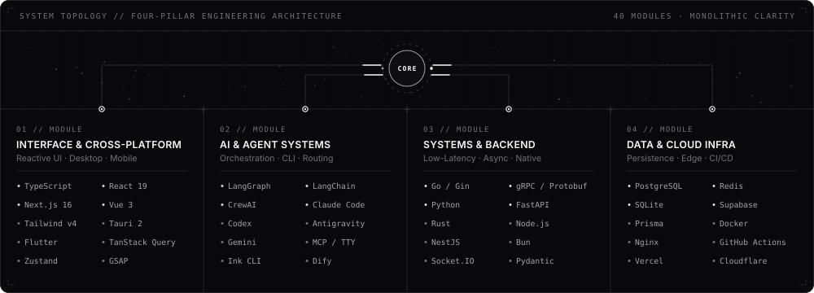

<!-- ═══════════════════════════════════ ACT 00 · KINETIC HERO ═══════════════════════════════════ -->
<a href="https://alkaid.live">
  <picture>
    <source media="(prefers-color-scheme: dark)" srcset="./assets/hero-dark.svg" />
    <source media="(prefers-color-scheme: light)" srcset="./assets/hero-light.svg" />
    
  </picture>
</a>

<!-- ═══════════════════════════════════ MONOCHROME TYPING PULSE ═══════════════════════════════════ -->
<a href="https://alkaid.live">
  <picture>
    <source media="(prefers-color-scheme: dark)" srcset="https://readme-typing-svg.demolab.com?font=JetBrains+Mono&weight=400&size=12&duration=3400&pause=1400&color=A1A1AA&center=true&vCenter=true&width=820&height=28&lines=Resist+entropy+with+order.+Hold+meaning+with+space.;Building+CLI+Coding+Agents+%C2%B7+Multi-Agent+Routers+%C2%B7+Local-First+Tools;TypeScript+%C2%B7+React+19+%C2%B7+Next.js+16+%C2%B7+Go+%C2%B7+Python+%C2%B7+Rust+%2F+Tauri+2;%CE%B7+Ursae+Majoris+%C2%B7+%E4%BB%A5%E7%A7%A9%E5%BA%8F%E6%8A%B5%E6%8A%97%E7%86%B5%E5%A2%9E%EF%BC%8C%E4%BB%A5%E7%A9%BA%E7%99%BD%E6%89%BF%E8%BD%BD%E5%86%85%E5%AE%B9" />
    <source media="(prefers-color-scheme: light)" srcset="https://readme-typing-svg.demolab.com?font=JetBrains+Mono&weight=400&size=12&duration=3400&pause=1400&color=52525B&center=true&vCenter=true&width=820&height=28&lines=Resist+entropy+with+order.+Hold+meaning+with+space.;Building+CLI+Coding+Agents+%C2%B7+Multi-Agent+Routers+%C2%B7+Local-First+Tools;TypeScript+%C2%B7+React+19+%C2%B7+Next.js+16+%C2%B7+Go+%C2%B7+Python+%C2%B7+Rust+%2F+Tauri+2;%CE%B7+Ursae+Majoris+%C2%B7+%E4%BB%A5%E7%A7%A9%E5%BA%8F%E6%8A%B5%E6%8A%97%E7%86%B5%E5%A2%9E%EF%BC%8C%E4%BB%A5%E7%A9%BA%E7%99%BD%E6%89%BF%E8%BD%BD%E5%86%85%E5%AE%B9" />
    
  </picture>
</a>

<!-- ═══════════════════════════════════ MONOCHROME INDEX & LIVE COUNTERS ═══════════════════════════════════ -->

  &nbsp;
  &nbsp;
  &nbsp;
  &nbsp;
  &nbsp;
  &nbsp;
  

<!-- ═══════════════════════════════════ SECTION 01 · ARCHITECTURE ═══════════════════════════════════ -->
<picture>
  <source media="(prefers-color-scheme: dark)" srcset="./assets/divider-01-dark.svg" />
  <source media="(prefers-color-scheme: light)" srcset="./assets/divider-01-light.svg" />
  
</picture>

<picture>
  <source media="(prefers-color-scheme: dark)" srcset="./assets/architecture-dark.svg" />
  <source media="(prefers-color-scheme: light)" srcset="./assets/architecture-light.svg" />
  
</picture>

  
<code>▸</code> <b>Seven-Star Engineering Codex (北斗七星 · 极客星宿谱) &amp; Complete Toolchain Spec</b>

   

> *“Alkaid（摇光）· 北斗之末 · 开阳之伴。每颗星辰，对应工程系统的一维法则。”*

| Index | Star · 星宿 | Engineering Domain | Deep Focus & Toolchain |
|:---:|:---|:---|:---|
| `01` | **天枢 · Dubhe** | **Interface & Cross-Platform** | **React 19** (Fiber / Hooks / Concurrent), **Vue 3**, **Next.js 16**, **Tailwind CSS v4**, **Vite**, **GSAP**; Cross-platform **Tauri 2**, **Flutter**, **uni-app**, **Electron**; **Bun / pnpm / Turborepo** |
| `02` | **天璇 · Merak** | **Reactive Data & State** | **TanStack Query** (SWR lifecycle, optimistic updates, background sync) & **Zustand** (`useSyncExternalStore` atomic state) — zero-jitter client data flow |
| `03` | **天玑 · Phecda** | **Systems & Persistence** | **Go (Gin, gRPC/Protobuf)**, **Python (FastAPI, Pydantic, Pandas)**, **Rust**, **Node.js (NestJS, Express, Socket.IO)**; **PostgreSQL**, **MySQL**, **SQLite**, **Redis**, **MongoDB**, **Prisma**, **TypeORM**, **Supabase** |
| `04` | **天权 · Megrez** | **Multi-Agent Orchestration** | **LangGraph** stateful DAGs, **LangChain**, **CrewAI**, **Dify**, Human-in-the-Loop reflective loops, structured tool-use & **Prompt Engineering** |
| `05` | **玉衡 · Alioth** | **AI Coding Platforms & Craft** | Building [**call-code**](https://github.com/AlkaidSTART/call-code), [**coderelay**](https://github.com/AlkaidSTART/coderelay), [**CreatorRelay**](https://github.com/AlkaidSTART/CreatorRelay); deep practice across **Claude Code**, **Codex**, **Antigravity**, **GitHub Copilot**, **Gemini**, **Pi**, **OMP**, **MCP** & **TTY** orchestration |
| `06` | **开阳 · Mizar** | **Writing & Systems Analysis** | Long-form architectural writing at [**alkaid.live**](https://alkaid.live) & [**掘金**](https://juejin.cn/user/3780587447942084) — dissecting React Fiber internals, async state engines & engineering clarity |
| `07` | **摇光 · Alkaid** | **Philosophy & Delivery** | *“once code, build everywhere”* — Docker, Nginx, GitHub Actions, Vercel, Cloudflare, Figma; shipping quiet, durable products from zero to one |

<!-- ═══════════════════════════════════ SECTION 02 · SELECTED WORKS ═══════════════════════════════════ -->
<picture>
  <source media="(prefers-color-scheme: dark)" srcset="./assets/divider-02-dark.svg" />
  <source media="(prefers-color-scheme: light)" srcset="./assets/divider-02-light.svg" />
  
</picture>

<a href="https://alkaid.live/projects/">
  <picture>
    <source media="(prefers-color-scheme: dark)" srcset="./assets/works-dark.svg" />
    <source media="(prefers-color-scheme: light)" srcset="./assets/works-light.svg" />
    
  </picture>
</a>

| No. | Project | Domain | Engineering Summary | Live Telemetry & Access |
|:---:|:---|:---|:---|:---|
| `01` | **[call-code](https://github.com/AlkaidSTART/call-code)** | `CLI Agent` | Local-first terminal coding agent (**TypeScript + Ink**) with natural-language file I/O, shell execution & long-term memory. |   |
| `02` | **[coderelay](https://github.com/AlkaidSTART/coderelay)** | `Agent Router` | Multi-coding-agent routing gateway & interactive TUI with adaptive task dispatch and live TTY session handoff. |   |
| `03` | **[Elonga](https://github.com/AlkaidSTART/Elonga)** | `AI Studio` | Unified content publishing & visual studio featuring multi-platform adaptation, compliance sanitization & local-first fallback. |   |
| `04` | **[CreatorRelay](https://github.com/AlkaidSTART/CreatorRelay)** | `Desktop / Rust` | Local-first **Rust + Tauri 2** unified creator workspace managing multi-platform publishing, analytics & controlled MCP workflows. |   |
| `05` | **[simple-design](https://github.com/AlkaidSTART/simple-design)** | `Creative Tool` | Lightweight WYSIWYG web design studio compressing the distance from concept to production-ready visuals. |   |
| `06` | **[NightHouse](https://github.com/AlkaidSTART/NightHouse)** | `3D Web Game` | *Midnight Villa (午夜别墅)* — First-person 3D suspense exploration game built with **PlayCanvas Engine 2**, **React 19** & **IndexedDB**. |   |

  
<code>▸</code> <b>Complete Project Archive · 56+ Original Repositories (Mirrored from alkaid.live/projects)</b>

   

| Category | Repositories & Live Deployments |
|:---|:---|
| **`AGENT` · AI & Orchestration** | **[DreamWeave](https://dream-weave-six.vercel.app)** · **[MemoAgent](https://github.com/AlkaidSTART/MemoAgent)** *(iterative long-term memory RAG)* · **[gisfy](https://gisfy.vercel.app)** *(AI 2D game asset studio)* · **[Doctor-copilot](https://github.com/AlkaidSTART/Doctor-copilot)** · **[cc-resource](https://github.com/AlkaidSTART/cc-resource)** · **[MetaVoice](https://meta-voice.vercel.app)** · **[StartHeart-management](https://start-heart-management.vercel.app)** · **[file-visual-manager](https://github.com/AlkaidSTART/file-visual-manager)** *(Rust + TS)* · **[AlkaidHome](https://github.com/AlkaidSTART/AlkaidHome)** · **[its](https://github.com/AlkaidSTART/its)** *(runner / model / policy)* |
| **`CREATIVE` · Visual & Audio** | **[simple-design](https://simple-design-zeta.vercel.app)** · **[LUMINA](https://github.com/AlkaidSTART/LUMINA)** · **[voice](https://voice-smoky-five.vercel.app)** · **[View-mindmap](https://github.com/AlkaidSTART/View-mindmap)** · **[SciCanvas](https://github.com/AlkaidSTART/SciCanvas)** · **[painter](https://github.com/AlkaidSTART/painter)** · **[Html-Home](https://github.com/AlkaidSTART/Html-Home)** |
| **`PRODUCT` · Apps & Utilities** | **[kaoyan-helper](https://kaoyan-helper-alpha.vercel.app)** (`★5`) · **[TimePulse](https://time-pulse-two.vercel.app)** *(timer & world clock)* · **[booklin](https://booklin.vercel.app)** · **[DAYFLOW](https://github.com/AlkaidSTART/DAYFLOW)** · **[DevWorkspace](https://github.com/AlkaidSTART/DevWorkspace)** · **[what-to-eat](https://what-to-eat-orcin-seven.vercel.app)** · **[markdown-live](https://markdown-live-vert.vercel.app)** · **[ScriptForge](https://script-backend-ten.vercel.app)** · **[todolist-pro](https://github.com/AlkaidSTART/todolist-pro)** · **[go-chatroom](https://github.com/AlkaidSTART/go-chatroom)** *(Flutter + Go)* · **[CodePaint-Resume](https://github.com/AlkaidSTART/CodePaint-Resume)** |

<!-- ═══════════════════════════════════ SECTION 03 · TELEMETRY OBSERVATORY ═══════════════════════════════════ -->
<picture>
  <source media="(prefers-color-scheme: dark)" srcset="./assets/divider-03-dark.svg" />
  <source media="(prefers-color-scheme: light)" srcset="./assets/divider-03-light.svg" />
  
</picture>

<a href="https://github.com/AlkaidSTART">
  <picture>
    <source media="(prefers-color-scheme: dark)" srcset="./assets/telemetry-dark.svg" />
    <source media="(prefers-color-scheme: light)" srcset="./assets/telemetry-light.svg" />
    
  </picture>
</a>

 

<!-- Monochrome Contribution Grid Snake -->
<picture>
  <source media="(prefers-color-scheme: dark)" srcset="https://raw.githubusercontent.com/AlkaidSTART/AlkaidSTART/output/github-contribution-grid-snake-dark.svg" />
  <source media="(prefers-color-scheme: light)" srcset="https://raw.githubusercontent.com/AlkaidSTART/AlkaidSTART/output/github-contribution-grid-snake.svg" />
  
</picture>

**`LIVE PULSE` · Real-Time GitHub Activity Stream** `auto-synced every 6h via GitHub Actions`

<!-- START_SECTION:activity -->
- `2026.11.28` · `PR #16` — [Merged Pull Request #16](https://github.com/AlkaidSTART/Elonga/pull/16) in **[AlkaidSTART/Elonga](https://github.com/AlkaidSTART/Elonga)**
- `2026.11.28` · `PR #15` — [Merged Pull Request #15](https://github.com/AlkaidSTART/Elonga/pull/15) in **[AlkaidSTART/Elonga](https://github.com/AlkaidSTART/Elonga)**
- `2026.11.28` · `PR #14` — [Closed Pull Request #14](https://github.com/AlkaidSTART/Elonga/pull/14) in **[AlkaidSTART/Elonga](https://github.com/AlkaidSTART/Elonga)**
- `2026.11.28` · `PR #13` — [Merged Pull Request #13](https://github.com/AlkaidSTART/Elonga/pull/13) in **[AlkaidSTART/Elonga](https://github.com/AlkaidSTART/Elonga)**
- `2026.11.28` · `PR #11` — [Merged Pull Request #11](https://github.com/AlkaidSTART/Elonga/pull/11) in **[AlkaidSTART/Elonga](https://github.com/AlkaidSTART/Elonga)**
- `2026.11.28` · `PR #12` — [Merged Pull Request #12](https://github.com/AlkaidSTART/Elonga/pull/12) in **[AlkaidSTART/Elonga](https://github.com/AlkaidSTART/Elonga)**
<!-- END_SECTION:activity -->

  
<code>▸</code> <b>Live External API Telemetry Mirrors (Stats · Streak · Languages · Pinned Cards)</b>

   
  

    <table>
      <tr>
        <td width="50%" align="center">
          <picture>
            <source media="(prefers-color-scheme: dark)" srcset="https://github-readme-stats.vercel.app/api?username=AlkaidSTART&show_icons=true&bg_color=09090b&title_color=fafafa&icon_color=a1a1aa&text_color=d4d4d8&ring_color=fafafa&border_color=222227&include_all_commits=true&count_private=true" />
            <source media="(prefers-color-scheme: light)" srcset="https://github-readme-stats.vercel.app/api?username=AlkaidSTART&show_icons=true&bg_color=fafafa&title_color=09090b&icon_color=52525b&text_color=27272a&ring_color=09090b&border_color=e2e2e7&include_all_commits=true&count_private=true" />
            
          </picture>
        </td>
        <td width="50%" align="center">
          <picture>
            <source media="(prefers-color-scheme: dark)" srcset="https://streak-stats.demolab.com?user=AlkaidSTART&background=09090b&border=222227&stroke=222227&ring=fafafa&fire=fafafa&currStreakNum=fafafa&sideNums=fafafa&currStreakLabel=a1a1aa&sideLabels=71717a&dates=52525b" />
            <source media="(prefers-color-scheme: light)" srcset="https://streak-stats.demolab.com?user=AlkaidSTART&background=fafafa&border=e2e2e7&stroke=e2e2e7&ring=09090b&fire=09090b&currStreakNum=09090b&sideNums=09090b&currStreakLabel=52525b&sideLabels=71717a&dates=a1a1aa" />
            
          </picture>
        </td>
      </tr>
      <tr>
        <td width="50%" align="center">
          <picture>
            <source media="(prefers-color-scheme: dark)" srcset="https://github-readme-stats.vercel.app/api/top-langs/?username=AlkaidSTART&layout=compact&langs_count=8&bg_color=09090b&title_color=fafafa&text_color=d4d4d8&border_color=222227" />
            <source media="(prefers-color-scheme: light)" srcset="https://github-readme-stats.vercel.app/api/top-langs/?username=AlkaidSTART&layout=compact&langs_count=8&bg_color=fafafa&title_color=09090b&text_color=27272a&border_color=e2e2e7" />
            
          </picture>
        </td>
        <td width="50%" align="center">
          <a href="https://github.com/AlkaidSTART/coderelay">
            <picture>
              <source media="(prefers-color-scheme: dark)" srcset="https://github-readme-stats.vercel.app/api/pin/?username=AlkaidSTART&repo=coderelay&bg_color=09090b&title_color=fafafa&icon_color=a1a1aa&text_color=a1a1aa&border_color=222227" />
              <source media="(prefers-color-scheme: light)" srcset="https://github-readme-stats.vercel.app/api/pin/?username=AlkaidSTART&repo=coderelay&bg_color=fafafa&title_color=09090b&icon_color=52525b&text_color=52525b&border_color=e2e2e7" />
              
            </picture>
          </a>
        </td>
      </tr>
    </table>
  

<!-- ═══════════════════════════════════ SECTION 04 · WRITING, ETHOS & CHANNELS ═══════════════════════════════════ -->
<picture>
  <source media="(prefers-color-scheme: dark)" srcset="./assets/divider-04-dark.svg" />
  <source media="(prefers-color-scheme: light)" srcset="./assets/divider-04-light.svg" />
  
</picture>

<table>
  <tr>
    <td width="55%" valign="top">

**`JOURNAL` · Technical Writing · [alkaid.live ↗](https://alkaid.live/blog/)**

<!-- START_SECTION:blog -->
- `2026.07.27` — **[深入浅出 React Hooks 原理：从 Fiber 的 memoizedState 链表讲到 updateQueue 调度](https://alkaid.live/blog/react-hooks/)** `7 min` 剖析 Hook 链表挂载机制、闭包陷阱本质与并发调度队列。
- `2026.04.10` — **[TanStack Query 技术指南：异步状态管理核心实践](https://alkaid.live/blog/TanStack%20Query%20%E6%8A%80%E6%9C%AF%E6%8C%87%E5%8D%97%EF%BC%9A%E5%BC%82%E6%AD%A5%E7%8A%B6%E6%80%81%E7%AE%A1%E7%90%86%E6%A0%B8%E5%BF%83%E5%AE%9E%E8%B7%B5/)** `8 min` 解析服务端状态生命周期、SWR 缓存策略、后台静默重验与乐观更新。
- `2026.04.02` — **[0 基础入门 Zustand：新手友好的 React 状态管理方案](https://alkaid.live/blog/0%20%E5%9F%BA%E7%A1%80%E5%85%A5%E9%97%A8%20Zustand%EF%BC%9A%E6%96%B0%E6%89%8B%E5%8F%8B%E5%A5%BD%E7%9A%84%20React%20%E7%8A%B6%E6%80%81%E7%AE%A1%E7%90%86%E6%96%B9%E6%A1%88/)** `3 min` 基于发布订阅与 useSyncExternalStore 的零样板原子化状态实践。
<!-- END_SECTION:blog -->

</td>
    <td width="45%" valign="top">

**`ETHOS` · Engineering & Design Principles**

- **Order against entropy** — *“以秩序抵抗熵增，以空白承载内容。”* Clarity, restraint, and structural stillness outlive trends.
- **Clarity over cleverness** — Systems must stay immediately legible six months later in a cold terminal.
- **Local-first & low-latency** — Respect the user's machine, keystrokes, privacy, and flow state.
- **Agents as force multipliers** — Pair deterministic toolchains with autonomous reasoning loops.

</td>
  </tr>
</table>

<table>
  <tr>
    <td width="34%" valign="top">

**`01 / DIRECT`**

- **Site** · [alkaid.live](https://alkaid.live)
- **Email** · [2595006848@qq.com](mailto:2595006848@qq.com)
- **WeChat** · `AlkaidSTART`
- **Base** · Chengdu · `UTC+8`

</td>
    <td width="34%" valign="top">

**`02 / CODE & WRITING`**

- **GitHub** · [@AlkaidSTART](https://github.com/AlkaidSTART)
- **Gitee** · [@ALIOTHK](https://gitee.com/ALIOTHK)
- **掘金** · [Alkaid](https://juejin.cn/user/3780587447942084)
- **CSDN** · [AlkaidSTART](https://blog.csdn.net/AlkaidSTART)

</td>
    <td width="32%" valign="top">

**`03 / ELSEWHERE & FRIENDS`**

- [X / Twitter](https://x.com/ALkadSTART) · [Bilibili](https://space.bilibili.com/1232479900) · [知乎](https://www.zhihu.com/people/promisezhu-wu-ying)
- [小红书](https://www.xiaohongshu.com/user/profile/67444201000000001d02f787) · [抖音](https://www.douyin.com/jingxuan/search/76049893831)
- **Friends** · [箫笋](https://sunn.net.cn) · [Jude.Chen](https://honos.dev)

</td>
  </tr>
</table>

<!-- ═══════════════════════════════════ ACT 05 · HORIZON COLOPHON ═══════════════════════════════════ -->
<a href="https://alkaid.live">
  <picture>
    <source media="(prefers-color-scheme: dark)" srcset="./assets/footer-dark.svg" />
    <source media="(prefers-color-scheme: light)" srcset="./assets/footer-light.svg" />
    
  </picture>
</a>

 

  <code>OPEN-SOURCE ARCHITECTURE</code> · Zero-dependency Python kinetic SVG &amp; telemetry engine · Customize via <a href="./profile.config.json"><code>profile.config.json</code></a> · <a href="./LICENSE"><code>MIT License</code></a>

